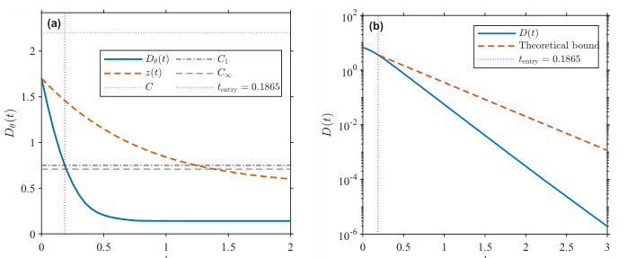
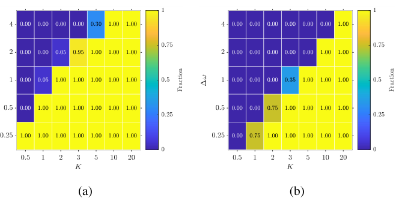
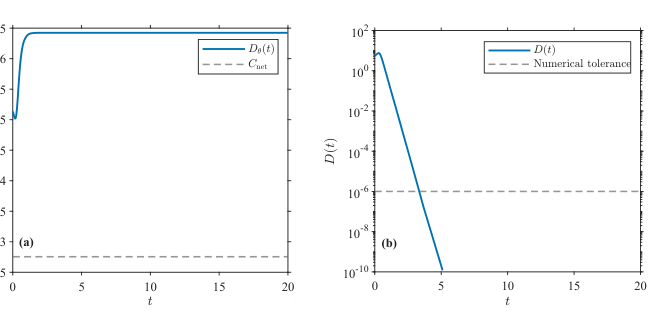
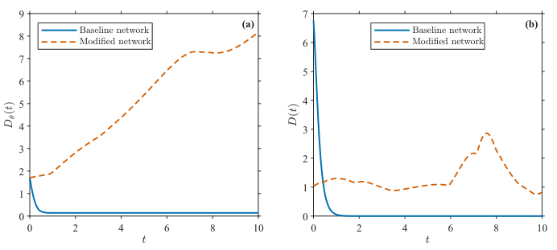

Frequency Synchronization of Signed Kuramoto Networks via a π-State Transformation
Authors: Sun-Ho Choi and Hyowon Seo  
Software: MATLAB  
Manuscript: Frequency synchronization of signed Kuramoto networks via a π-state transformation
This repository contains MATLAB code for the numerical experiments in Section IV of the manuscript. The experiments examine frequency synchronization in directed, weighted conformist–contrarian Kuramoto networks, the theoretical synchronization certificate, and the effects of coupling gain, network structure, and initial conditions.
Quick start
Save `run_signed_kuramoto.m` in your MATLAB working directory, or add the repository folder to the MATLAB path.
```matlab
% Algebraic consistency checks
[results, outdir] = run_signed_kuramoto('selftest');

% Preliminary run with reduced sample sizes
[results, outdir] = run_signed_kuramoto('quick', [], struct('Visible','off'));

% Experiments in manuscript Section IV
[results, outdir] = run_signed_kuramoto('full', [], struct('Visible','off'));
```
The `full` mode uses the sample sizes specified in the manuscript and can require substantial computation time and disk space. Run `selftest` and `quick` before `full`.
Experiments in the manuscript
Section IV-A — Certified synchronization
Fig. 1(a): Transformed phase diameter, scalar comparison equation, and certified bounds. Output: `01_phase_entry.*`.
Fig. 1(b): Frequency-diameter decay and theoretical exponential envelope. Output: `02_frequency_envelope.*`.
Table I: Deterministic certificate for the baseline example. Outputs: `baseline_certificate.csv` and `configuration.mat`.
Section IV-B — Behavior beyond the certified region
Fig. 2(a): Frequency synchronization fraction over the gain–frequency mismatch grid. Output: `08_map_frequency.*`.
Fig. 2(b): Fraction certified by Theorem II.1 on the same grid. Output: `09_map_certificate.*`.
Fig. 3(a): Lifted transformed phase diameter for unrestricted initial phases. Output: `11_unrestricted_phase_diameter.*`.
Fig. 3(b): Frequency diameter for the corresponding trajectory. Output: `12_unrestricted_frequency_diameter.*`.
Fig. 4(a): Phase-diameter comparison between the baseline and modified networks. Output: `13_modified_network_phase.*`.
Fig. 4(b): Frequency-diameter comparison between the two networks. Output: `14_modified_network_frequency.*`.
Section IV-C — Convergence and network structure
Table II: Gain-dependent synchronization and rate estimates (100 paired trials per gain). Outputs: `gain_trials.csv` and `gain_uniform_certificate.csv`.
Table III: ER, WS, and BA network ensembles (30 trials per setting). Outputs: `topology_trials.csv` and `topology_summary.csv`.
Table IV: Fixed-expected-degree ER networks with and without gain normalization (30 paired trials per size). Outputs: `fixed_degree_trials.csv` and `fixed_degree_summary.csv`.
For parameter grids, figure descriptions, and auxiliary experiments, see FIGURES.md. The numerical prefixes above refer to generated filenames, not manuscript figure numbers.
Manuscript figures
The images below are extracted from the supplied manuscript PDF for reference. They were not generated by a fresh run of this repository.
Fig. 1 — Certified phase and frequency estimates

Fig. 2 — Gain and frequency mismatch

Fig. 3 — Unrestricted initial phases

Fig. 4 — Modified source weights

Requirements
MATLAB with `ode45`, `tiledlayout`, `exportgraphics`, and `savefig`.
No additional MATLAB toolboxes are required by the source code.
Compatibility with older MATLAB releases and GNU Octave has not been established.
Running individual experiments
```matlab
% Sections IV-A and IV-B: Figs. 1–4 and Table I
[results, outdir] = run_signed_kuramoto('ab', [], struct('Visible','off'));

% Section IV-C: Tables II–IV and auxiliary plots
[results, outdir] = run_signed_kuramoto('c', [], struct('Visible','off'));

% Fig. 2 and Fig. 3 experiments only
[results, outdir] = run_signed_kuramoto('additional', [], struct('Visible','off'));
```
Other available modes are `gain`, `sparse`, `topology`, `degree`, `modified`, and `core`. To regenerate figures from a previous run, where supported:
```matlab
[results, outdir] = run_signed_kuramoto('replot', 'PATH_TO_PREVIOUS_RESULTS', struct('Visible','off'));
```
Settings can be overridden using the third argument:
```matlab
opts = struct('Visible','off','Seed',20261010,'TMax',150);
[results, outdir] = run_signed_kuramoto('ab', 'results_AB', opts);
```
Use a new output directory for each run. The code does not overwrite an existing `results.mat`.
Mathematical model
The oscillator phases satisfy
$$
\dot\theta_i = \omega_i + \frac{K}{N}s_i\sum_{j=1}^{N}a_{ij}\sin(\theta_j-\theta_i),
\qquad s_i\in{-1,+1}.
$$
Here, $a_{ij}\geq0$ represents input from oscillator $j$ to oscillator $i$. The transformed phases are
$$
\widetilde\theta_i(t)=\theta_i(t)-\frac{1-s_i}{2}\pi-\bar\omega t,
\qquad \bar\omega=\frac{1}{N}\sum_i\omega_i.
$$
The implementation uses $B=A\operatorname{diag}(s)$. The transformed system is not cooperative: conformist sources provide attraction, whereas contrarian sources provide repulsion. The transformed phase diameter is computed from unwrapped real-valued phase lifts, not from phases reduced modulo $2\pi$.
Numerical settings and output
The default solver is `ode45` with relative tolerance $10^{-9}$ and absolute tolerance $10^{-11}$. Each trial is integrated for at least 20 time units. It stops after a completed integration block if the maximum frequency diameter over the preceding 5 time units is at most $10^{-6}$, or when the final time reaches 100.
The synchronization certificate from Theorem II.1 is evaluated independently of this finite-time numerical criterion. Failure to reach the numerical threshold within the simulated time interval is not a proof of non-synchronization.
Results are written to `results_signed_kuramoto_<mode>_<timestamp>/` by default. Depending on the selected mode, output includes:
`configuration.mat` — simulation options, MATLAB version, and random seed.
`results.mat` — trial records and experiment summaries.
`trials/*.mat` — network weights, oscillator signs, frequencies, initial phases, and trial results.
`*_trials.csv` and `*_summary.csv` — trial-level and aggregate statistics.
`.fig`, `.pdf`, `.eps`, and `.png` — generated plots.
The default random seed is `20261010`. Individual trial seeds and sampled input arrays are retained. The baseline example has $N_p=7$, $N_m=3$, $K=10$, $C=2.2$, and $C_1=0.75$.
Several manuscript panels are exported as separate plots, so the output arrangement may differ from the paper. The provided code has not been run in this environment or numerically checked against every value printed in the manuscript tables; an independent MATLAB execution is required before claiming exact numerical replication.
Citation and license
Citation metadata are provided in CITATION.cff. Publication details can be added after the article is published.
The repository's public visibility does not by itself grant permission to modify or redistribute the code. A license should be selected by the copyright holders before granting those rights.
